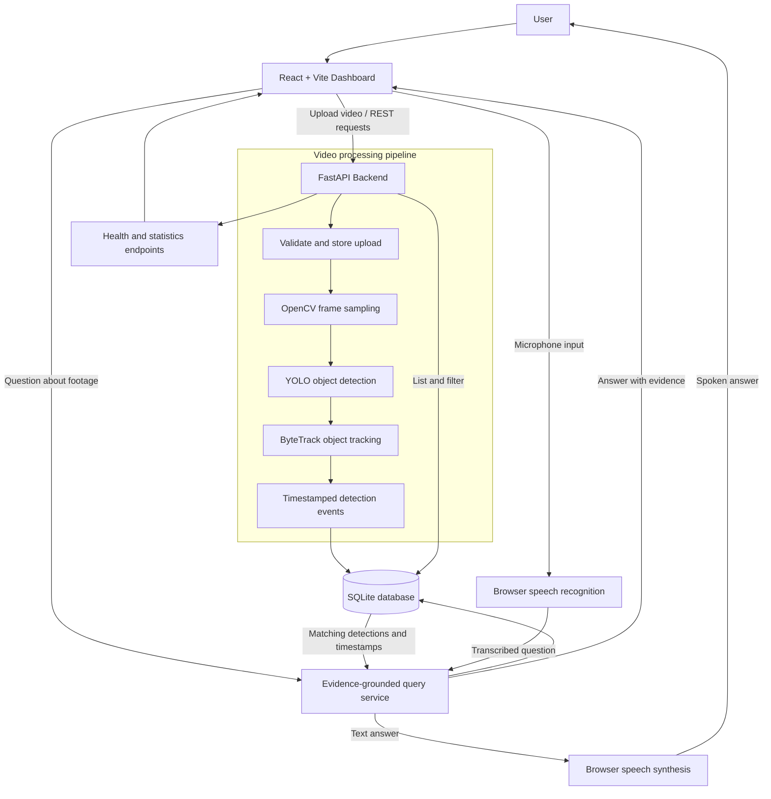

# Sentinel AI — Video Intelligence Workbench

Sentinel AI is an end-to-end video analytics prototype built to demonstrate computer vision, object tracking, evidence-grounded retrieval, API design, and a React dashboard. It is designed as an engineering project for experimentation—not as a safety-certified surveillance product.

## What works

- **Video ingestion:** upload MP4, MOV, AVI, MKV, or WEBM clips (default 250 MB limit).
- **Computer vision:** YOLO object detection with confidence scores and bounding boxes.
- **Tracking:** Ultralytics ByteTrack IDs where the tracker returns an ID.
- **Event storage:** timestamp, frame number, label, confidence, tracking ID, and bounding box stored in SQLite.
- **Event explorer:** filter events by video and class label.
- **Evidence-grounded questions:** retrieve timestamped detections and summarize what the detector recorded. It does not claim that a missed detection proves an object was absent.
- **Browser voice controls:** microphone input and spoken answers when supported by the browser; microphone permission is required.
- **Video management:** delete a video and its event records.
- **Engineering basics:** API validation, upload size limits, Docker configuration, tests, experiment template, and continuous integration.

## Architecture

```text
React + Vite dashboard
   | REST / JSON + multipart upload
   v
FastAPI service ---- /api/ask ----> evidence-grounded retrieval
   |
   +---- OpenCV frame sampling
   |        |
   |        v
   |      YOLO detection + ByteTrack
   |        |
   |        v
   +---- SQLite video metadata + timestamped events
```

The question-answering feature is intentionally retrieval-based and deterministic. It is not an LLM agent and does not perform temporal action recognition. Browser speech is browser-provided speech recognition and speech synthesis, not a custom trained speech model.

## Requirements

- Python 3.11 recommended
- Node.js 20 or later
- A machine that can run the selected Ultralytics model; a compatible NVIDIA GPU can accelerate inference, but a CPU can also run smaller models more slowly.
- Internet access on the first model run if the configured YOLO weights are not cached.

## Local setup

### 1. Backend

From the repository root:

**Windows PowerShell**
```powershell
cd backend
python -m venv .venv
.venv\Scripts\Activate.ps1
python -m pip install --upgrade pip
pip install -r requirements.txt
$env:SENTINEL_MODEL="yolov8n.pt"
$env:SENTINEL_SAMPLE_INTERVAL="0.5"
uvicorn app.main:app --reload
```

**macOS / Linux**
```bash
cd backend
python3 -m venv .venv
source .venv/bin/activate
python -m pip install --upgrade pip
pip install -r requirements.txt
export SENTINEL_MODEL=yolov8n.pt
export SENTINEL_SAMPLE_INTERVAL=0.5
uvicorn app.main:app --reload
```

The API runs at [http://127.0.0.1:8000](http://127.0.0.1:8000). Interactive API documentation is available at [http://127.0.0.1:8000/docs](http://127.0.0.1:8000/docs). The backend creates the database and upload directory automatically.

### 2. Frontend

Open a second terminal at the repository root:

```bash
cd frontend
npm install
npm run dev
```

Open [http://localhost:5173](http://localhost:5173). If the backend is not running, the dashboard displays a disconnected status.

Optional frontend API override: copy `frontend/.env.example` to `frontend/.env` and set `VITE_API_BASE` before starting Vite.

### 3. Docker Compose

From the repository root:

```bash
docker compose up --build
```

Then open [http://localhost:5173](http://localhost:5173). Docker Compose stores uploaded videos and the SQLite database in named volumes. The default Compose setup uses CPU inference unless the container is explicitly configured for GPU access.

## System architecture



## API reference

| Method | Endpoint | Purpose |
|---|---|---|
| GET | `/health` | Service health |
| GET | `/api/videos` | List processed videos |
| POST | `/api/videos` | Upload and process a video; multipart field: `file` |
| DELETE | `/api/videos/{video_id}` | Delete a video and its event records |
| GET | `/api/events?video_id=1&label=person` | Search timestamped detections |
| GET | `/api/stats` | Basic counts and frequent labels |
| POST | `/api/ask` | Ask a question about stored detection evidence |

Example question request:

```json
{
  "question": "When was a person detected?",
  "video_id": 1
}
```

Use `POST /api/ask` with a JSON body and `Content-Type: application/json`.

## Configuration

Settings use environment variables with the `SENTINEL_` prefix.

| Variable | Default | Description |
|---|---|---|
| `SENTINEL_MODEL` | `yolov8n.pt` | Ultralytics model/checkpoint |
| `SENTINEL_DB_PATH` | `./sentinel.db` | SQLite database path |
| `SENTINEL_UPLOAD_DIR` | `./uploads` | Video storage directory |
| `SENTINEL_SAMPLE_INTERVAL` | `0.5` | Target interval between sampled frames in seconds |
| `SENTINEL_MAX_VIDEO_MB` | `250` | Maximum upload size |

The frame sampler reads the clip sequentially and runs inference at the configured interval. For long videos, processing can take several minutes. The current implementation is synchronous per upload and is intended for a single-user demonstration, not high-throughput production.

## Tests and quality checks

Backend unit tests:

```bash
cd backend
pip install -r requirements.txt
PYTHONPATH=. pytest -q
```

Frontend production build:

```bash
cd frontend
npm install
npm run build
```

GitHub Actions runs backend unit tests and the frontend production build on pushes and pull requests to `main`.

## Experiment methodology

Use [docs/EXPERIMENTS.md](docs/EXPERIMENTS.md) to record the dataset, hardware, model, inference interval, precision, recall, mean average precision, processing speed, memory use, and failure cases. Compare runs only when the evaluation split and conditions are controlled. Do not put unmeasured accuracy or latency claims in a portfolio or resume.

Suggested experiments:
1. Compare YOLO nano and small models on the same held-out clips.
2. Compare 0.25, 0.5, and 1.0-second sampling intervals.
3. Evaluate precision and recall by object class and lighting condition.
4. Measure tracking identity switches and missed detections.
5. Profile CPU versus GPU inference with the same resolution and test set.

## Known limitations and next steps

- No trained temporal action-recognition model yet.
- No custom automatic speech recognition or text-to-speech model; voice controls rely on browser capabilities.
- Question answering is retrieval and summarization, not a large language model or autonomous agent.
- No authentication, user accounts, rate limiting, persistent job queue, or production retention controls.
- SQLite and the synchronous inference workflow are suitable for a local prototype, not multi-tenant scale.
- Add representative dataset evaluation, annotated video playback, background jobs, authentication, deployment monitoring, and documented benchmark results before production use.

## Responsible use

Use footage you have permission to process. Provide appropriate notice and follow applicable privacy and data-retention requirements. Detection is probabilistic; do not use this prototype as the sole basis for decisions affecting people's safety, employment, access, or rights.
